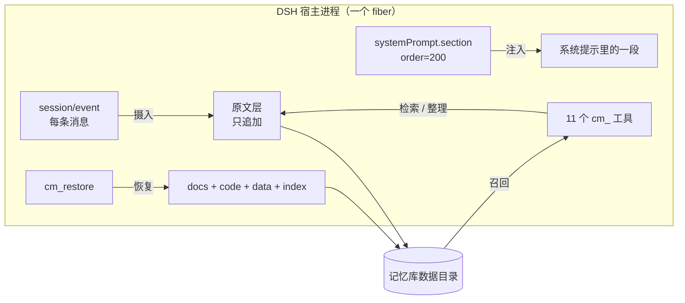
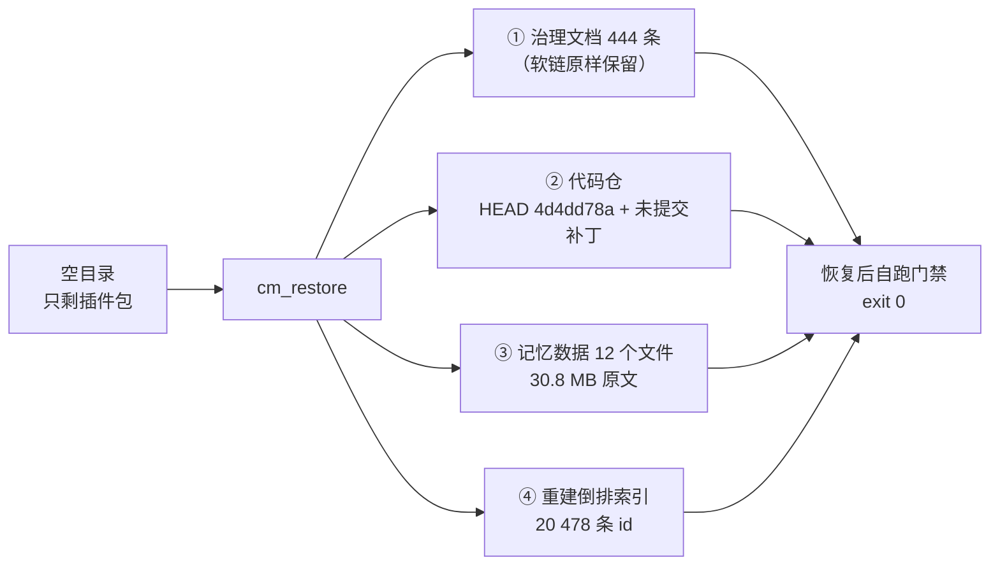
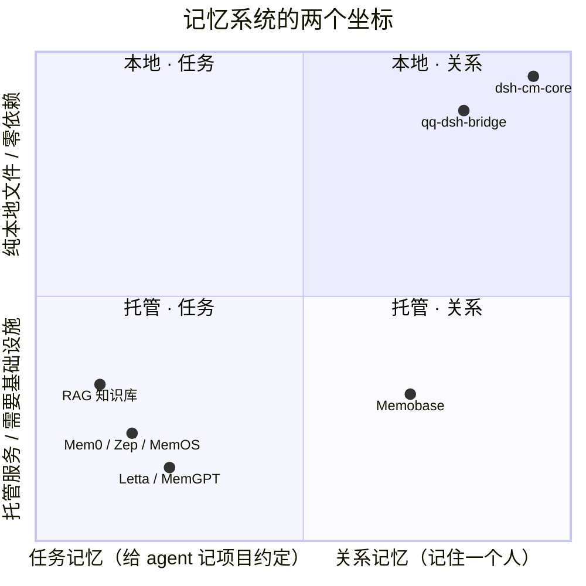

# 它能做什么 · 它做了什么 · 和市面上的有什么不同

> 一页看清 dsh-cm-core 的定位、实测与边界。
> 想读实现细节去 **[`TECHNICAL-REPORT.md`](TECHNICAL-REPORT.md)**；想装去 **[`README.md`](README.md)**。


---

## 一句话

把一个**外挂脚本形态**的长期记忆库，收进 DeepSeek Harness 宿主进程的**一个插件**里：
注入、摄入、检索、恢复四件事共用一个生命周期。**数据全丢时，只靠这一个插件就能把项目恢复回来。**

---

## 一、它能做什么

四件事原来各挂各的，**失效点互相不知道**。这张表是旧形态的真实失效面：

| 职责 | 旧做法 | 失效时**你看到的样子** |
|---|---|---|
| 注入 | `cm-agents.js` 改写 `AGENTS.md` 的标记段 | 宿主只在首个请求加载它；切到生活侧，工作侧口径照样灌进去 |
| 摄入 | `cm-watch.js` 定时扫会话文件 | 守护进程没拉起 → **一条都不进**，且不报错 |
| 检索 | 人手动敲 `cm recall "…"` | 模型根本不知道有记忆库 |
| 恢复 | 无 | 丢一次就没了 |

现在它们长这样：



| 能力 | 入口 | 它做什么 |
|---|---|---|
| **注入** | 自动，每轮 | 在系统提示里加一段 `[记忆库 · 现在记得的事]`：印象层 + 「最近说过的话」。**按会话角色（work/life）与会话工作目录动态渲染**，不是写死的静态文件 |
| **摄入** | 自动，事件驱动 | 监听 `session/event`，把 user / assistant 消息写进原文层；判据直接复用库内核的 `flatten`，不重写一套 |
| **检索** | `cm_recall` | 词面 bigram + 向量（bge-m3 1024 维）融合 → 精排 → MMR 去重 → 按预算装包 |
| **精读** | `cm_read` | 按 id 取全文 / 同会话上下文 / 词面相关追查链 |
| **记东西** | `cm_remember` / `cm_know` / `cm_selfnote` | 印象（提炼判断，过人格红线）/ 原文知识 / 自我叙述（L4，**不进注入**） |
| **整理** | `cm_archive` | 归档 = 不再被召回，**原文一个字节不动**，`undo` 可完整退回 |
| **状态** | `cm_status` / `cm_layers` | 库在哪、什么角色、看得见哪几层；三层蒸馏各多少条 |
| **补灌** | `cm_ingest` | 把磁盘上已有历史会话补进库（按 id 判重） |
| **续接** | `cm_handoff` | 拼一份跨会话续接包 |
| **恢复** | `cm_restore` | 四层原料一次到位 |

> **11 个工具**，全部走 `ctx.inject(['tools'])` 注册。
> 下面这张表是「刻意不做」的一半 —— 不做，不是因为没写完：

| 不做 | 理由 |
|---|---|
| 自省 | 需外发模型加工，成本与不确定性高；留在 CLI 手动跑 |
| gc / 物理删除 | 不可逆整理，不适合交给模型自主调用 |
| 批量导入 | 一次性运维动作，不是会话内需求 |
| 多设备同步 | 已由独立插件承担，职责不该合并 |
| 快照自动重打 | 挂提交钩子会让每次 commit 背 3 秒副作用；只有检测、没有自动重打，是取舍 |

---

## 二、它做了什么

不是「设计目标」，是这台机器上**量出来的**数。

### 2.1 库里有东西

| 指标 | 实测值 |
|---|---|
| 原文层 | **22 634 条 id** / 29.7 MiB（按月分片，只追加） |
| 印象层 | **226 条**（live 168 / archived 58 / pinned 22） |
| 印象来源分布 | `user_said` 122 · `imagined` 76 · `inferred` 27 · `told` 1 |
| 向量索引 | **18 138** 条，`BAAI/bge-m3`，1024 维 |
| 时间跨度 | 2026-10 起，两个月份分片 |

### 2.2 恢复演练（这是项目的验收标准）

只留 5 个东西（`package.json` / `cordis.patch.yml` / `lib` / `vendor` / `snapshot`），其余**全部删掉**，然后：



| 实测项 | 结果 |
|---|---|
| 总耗时 | **1.9 – 3.0 s**（多次演练） |
| 恢复后自检 | `doc-gate-root` / `doc-gate-status` 均 exit 0 |
| 恢复后可用 | 注入段 ~575 字符、11 个工具全注册、`recall` 命中真实记忆 |
| 安全性 | 校验解压后 sha256（任一不符则**一条不写**）、默认只补不覆盖 |

> 四层原料里有两层容易被忽略：
> **未提交改动补丁**（`git bundle` 只打已提交内容，少这层，恢复出的代码会**悄悄**退回修复前的行为）、
> **移交标记文件**（少了它，恢复后定时脚本会把静态注入段重新写回 `AGENTS.md`，等于恢复动作本身把项目退回旧形态）。

### 2.3 代码规模

| 部分 | 行数 |
|---|---|
| `lib/`（插件本体：入口 + 库目录解析 + 恢复） | 1 216 |
| `scripts/`（快照 + 发布流水线） | 507 |
| `tests/`（零依赖自测 31 条） | 468 |
| `vendor/`（记忆库内核全量副本，45 个文件） | 14 834 |
| **运行时第三方依赖** | **0** |

自测两种口径，**跳过就计数，不假装通过**：

```
无 snapshot 的发布版：23 通过 / 0 失败 / 8 跳过
带 snapshot 的完整包：31 通过 / 0 失败 / 0 跳过
```

---

## 三、和市面上有什么不同

先把**比较对象**摆清楚。市面上叫「记忆」的东西分两类，混着比会得出错误结论：



| 维度 | 主流做法（Mem0 / Zep / MemOS / Letta） | 本项目 |
|---|---|---|
| **目标** | 任务记忆：给 agent 记「这个项目的约定」「上次那个 bug」 | **关系记忆**：记住的是**一个人**，不是一份文档 |
| **存储形态** | 抽取式：把对话提炼成 fact / 图节点，原文往往不保留 | **原文即真源**：全存原文，只追加；提炼出的「印象」是附加层，不当替代品 |
| **基础设施** | 常需向量库 / 图库 / 容器（Neo4j、Qdrant、Docker） | **零服务、零依赖**：纯 JS + 文件（JSONL / Float32Array） |
| **失败模式** | 召回率不够 —— 想不起来 | **说了不该说的话** —— 越界、把私下的事带出去、把猜测说成「你说过」 |
| **可见范围** | 通常一套权限或不过滤 | **单向门**：工作侧永远看不见生活侧，库内核三处同时保证 |
| **注入** | SDK 调用，agent 得自己记得调 | **宿主每轮自动渲染**，口径随会话变 |
| **灾后** | 靠备份 / 云 | **插件自带原料**，`cm_restore` 一次到位 |

### 3.1 最关键的一条差异：原文 vs 提炼

这不是口味问题，有外部证据（**以下为 HIVE 基准的自述结论，本项目未独立复现**）：

| 自述结论 | 内容 |
|---|---|
| 引文可定位性 | 抽取式三家（Mem0 / MemOS / Hindsight）的引文在**自家材料内** 98–100% 可定位，在**原语料内 0%**；原文路线（BM25 / 灵枢 / OpenViking）两栏都 ≈100% |
| 压缩的方向性偏差 | 压缩丢的不是随机信息，是**与提问词面不重叠的那一侧**；9 条结构性矛盾题，无筛选 BM25 保住 9/9，抽取式 0–1/9 |
| 写入成本 | 跨 4 个数量级，**与效果无关** —— 别为省存储牺牲原文 |

本项目自己的实测（**714 题基准，本地实跑**）：全存原文 **83.5%**，高于提炼类方案。
所以这个项目的取舍不是「我们更聪明」，而是「**在这个场景里，原文就是最便宜也最可靠的表征**」。

> 引用纪律：外部数字一律标「自述」，自己的数字标「本地实跑」，两者不混。
> 详见 `TECHNICAL-REPORT.md` §8.5。

### 3.2 和同生态的几个项目比

| 项目 | 关系 | 差异 |
|---|---|---|
| `qq-dsh-bridge`（NoMindSama，MIT） | **设计源头**：本项目 `store` / `search` / `impressions` 改自它 | 它提供四层结构（L0 原文 / L1 摘要 / L2 事实 / L3 产物）+ **L4 自我认知**；本项目把它从「一套脚本」变成「一个宿主插件」，并补上单向门与恢复 |
| `dsh-memu-memory` | 同为 DSH 记忆插件 | 面向长篇 RP，单人维护的新项目；本项目面向单人陪伴 + 工作侧隔离 |
| `dsh-fish` / `dsh-memory`（灵枢） | **上游算法** | IDF 公式与装包估算器逐字移植，已在报告 §8.1 逐条标注 |
| `Memobase` | 目标最接近（受众写着 ai-companion） | Python 服务 + 云 embedding；本项目要求零服务、纯本地 |
| `BAAI/BioCore`、`astrbot_plugin_biocore` | **只看思路**（AGPL-3.0） | MMR 与情绪层四思路；**未引依赖、未复制代码** |

### 3.3 独有的一件事：插件自带恢复原料

大多数记忆方案能回答「怎么记、怎么取」。能回答**「服务器没了怎么办」**的不多，而**把恢复原料打进插件自己包里**的，我没在同类项目里见过。

这也是本项目的验收标准写得那么奇怪的原因 —— 不是「召回率高」，而是：

> **数据全面丢失时，只通过一个插件就完全恢复我们的项目。**

---

## 四、它的代价（不适用场景）

诚实列出来，免得有人选错：

| 限制 | 说明 |
|---|---|
| **定档** | 作者不再维护，不接 issue / PR，不做兼容承诺；对着 `dsh 0.2.2-rc.1` 写成，宿主接口一变就可能失效 |
| **`vendor/` 冻结** | 45 个模块是 2026-11-26 那一刻内核的全量副本，不跟随上游更新 |
| **不含快照** | 公开仓不带 `snapshot/`（含真实个人记忆原文），得自己在自己机器上生成 |
| **单机** | 多设备同步仍在独立插件里，没合并进来 |
| **中文优先** | 词面通道是中文 2 字 bigram 倒排；其他语种主要靠向量通道 |
| **向量需自备额度** | 默认关闭；开启要 embedding API（默认 `BAAI/bge-m3`） |

---

## 五、一句话总结

> 市面上多数「记忆」在解决**记不住**。
> 这个项目在解决**记太随便、提太随便**，以及**记的东西丢了救不回来**。

---

<sub>本页所有数字来自 2026-11-26 / 11-27 在本机的实测输出；外部项目结论标注了「自述」。
定档版本 v0.1.3 · MIT · 详见 [TECHNICAL-REPORT.md](TECHNICAL-REPORT.md)</sub>
